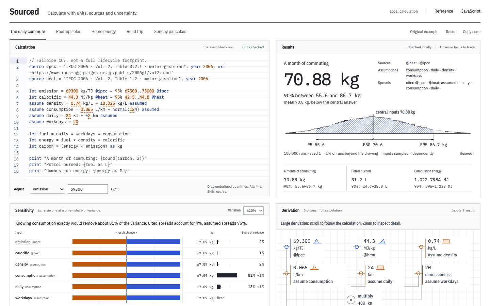

# Sourced
[](https://harryfreeman.dev)

Sourced is a calculation pad built on a small programming language in which every number carries its unit and its source, and, when it is uncertain, a spread that is either cited or marked as assumed. The checker refuses an unsourced number and checks every unit, each answer can show exactly where it came from, and an uncertain answer becomes a distribution of 100,000 runs with a variance-based sensitivity analysis that says which uncertainty actually matters. Most numbers people rely on, a carbon footprint or a payback period, hide both where their inputs came from and how sure anyone is about them. Sourced makes both visible, and keeps them attached as you change the calculation.



## Try it

Node 22.13 or later. From this folder:

```sh
npm ci --ignore-scripts
npm run dev
```

Open http://127.0.0.1:4177 (the dev server listens on your machine only). The commute opens with 70.88 kg of CO₂, a 90% interval of about 56–87 kg, and the sentence “Knowing consumption exactly would remove about 81% of the variance”. Drag the underlined `0.065` and the distribution moves with it on every frame; let go and it refines. Then open **Rooftop solar**: the payback is 9.86 years at average inputs, but the average payback is longer.

Everything runs in the browser. There is no model, no account and no runtime network request; the fonts are served from this folder. The Adjust field is the keyboard alternative to dragging; Alt makes a drag 100× finer, Shift 10× coarser, and Escape cancels it.

A production build:

```sh
npm run build
npm run preview -- --port 4177 --strictPort
```

Checks:

```sh
npm run check     # typecheck, lint, formatting, unit tests, build, licence check
PLAYWRIGHT_BROWSERS_PATH="$PWD/.cache/browsers" node node_modules/playwright/cli.js install chromium webkit firefox
node scripts/serve-built.mjs   # serves the build on a free local port and prints its URL
SOURCED_URL=<that URL> npm run test:browser   # also test:layout, test:shift, test:contrast, measure:browser
```

## How it works

**The language.** A hand-written lexer and Pratt parser, a checker with exact rational unit dimensions, an interpreter, and a compiler to JavaScript. Every literal needs a unit and a declared `@source`, or an explicit `assume`. Every value carries a node in a provenance graph, so a result can name each source and assumption behind it, and the editor can light up the exact code it depends on. Errors point at the exact span with a plain explanation and a suggestion. The compiled JavaScript and the interpreter agree on every output, binding and lineage node of every example.

```sourced
let emission = 69300 kg/TJ @ipcc ~ 95% 67500..73000 @ipcc
assume consumption = 0.065 L/km ~ normal(12%) assumed
assume daily = 24 km ~ ±2 km assumed
```

**Uncertainty, with provenance.** A clause after any quantity says how uncertain it is and who says so. A spread without `@source` or `assumed` is an error, as is one that excludes its own value or has the wrong unit. `±w` and `low..high` give limits only, so they are uniform (GUM, JCGM 100:2008 §4.3.7). `95% low..high` is a stated coverage interval, such as a published confidence interval: Sourced draws a two-piece normal that keeps the value as its mode and puts exactly that share of runs between the limits. `normal(sd)`, `lognormal(factor)`, `triangular(low, high)` and `uniform(low, high)` name the shape directly.

**Monte Carlo propagation** (JCGM 101:2008). Each run draws every uncertain input and recomputes the whole program. Units are fixed at check time, so a column evaluator runs the checked syntax tree once per operation over a whole column of runs (Float64Arrays); it reproduces the scalar interpreter bit for bit. Each quantity has its own seeded xoshiro128** stream, mapped through inverse CDFs, so the same seed gives the same runs, and dragging one number reuses everyone else’s random numbers: the shape moves instead of flickering. A 4,096-run preview is drawn in the same frame as the drag; a worker refines to 100,000 runs when you let go. A run that divides by zero or takes a negative square root is counted as undefined for the result it breaks, and excluded.

**Sensitivity, two ways.** The tornado nudges one input at a time by ±5, 10 or 20%. The variance share asks a different question: how much of the result’s spread comes from each input’s declared uncertainty. First-order Sobol indices (Saltelli et al. 2010) give the share that knowing an input exactly would remove; total indices (Jansen 1999) add every interaction it takes part in, drawn as a hatched extension. The design costs (k + 2) × 16,384 runs, with 95% bootstrap intervals. A sentence above the table states the finding, written by rule from the numbers on screen.

**The page.** An engineer’s calculation pad and a technical drawing: the derivation is an orthogonal schematic, and each distribution is drawn as a toleranced drawing, with section hatching for the central 90%, a chain dimension through P5, P50 and P95, a centre line for the median and a datum line for the answer at central inputs. Type is IBM Plex, self-hosted, with local fallbacks sized to Plex’s metrics so loading shifts nothing. The design notes are in [IDENTITY.md](IDENTITY.md).

**Methods**

- JCGM 101:2008, *Propagation of distributions using a Monte Carlo method*, and JCGM 100:2008 (GUM). [BIPM JCGM publications](https://www.bipm.org/en/committees/jc/jcgm/publications).
- I. M. Sobol′ (2001), Global sensitivity indices for nonlinear mathematical models and their Monte Carlo estimates. *Mathematics and Computers in Simulation* 55, 271–280. [doi:10.1016/S0378-4754(00)00270-6](https://doi.org/10.1016/S0378-4754(00)00270-6)
- A. Saltelli et al. (2010), Variance based sensitivity analysis of model output. Design and estimator for the total sensitivity index. *Computer Physics Communications* 181(2), 259–270. [doi:10.1016/j.cpc.2009.09.018](https://doi.org/10.1016/j.cpc.2009.09.018)
- M. J. W. Jansen (1999), Analysis of variance designs for model output. *Computer Physics Communications* 117, 35–43. [doi:10.1016/S0010-4655(98)00154-4](https://doi.org/10.1016/S0010-4655(98)00154-4)
- D. Blackman, S. Vigna (2021), Scrambled linear pseudorandom number generators. *ACM Transactions on Mathematical Software* 47(4). [doi:10.1145/3460772](https://doi.org/10.1145/3460772)
- P. J. Acklam (2003), An algorithm for computing the inverse normal cumulative distribution function.
- R. J. Hyndman, Y. Fan (1996), Sample quantiles in statistical packages. *The American Statistician* 50(4), 361–365. [doi:10.2307/2684934](https://doi.org/10.2307/2684934)

## What it measures

**Against closed forms** (`npm test`, 98 tests, 100,000 runs, seed 1):

| Case | Result |
| --- | --- |
| A sum of normals in kilometres and miles | P5, P50 and P95 within 0.003 km of the analytic values |
| A product of lognormals (kWh × kg/kWh) | Quantiles and mean within 0.26% |
| Sobol indices of X₁·X₂, whose interaction is exact | S₁ 0.884 (exact 0.889), T₁ 0.944 (0.944), S₂ 0.054 (0.056), T₂ 0.109 (0.111) |
| An additive model | S = T = ⅕, ⅘, 0, within 0.03 |
| The two-piece normal | 95% of 200,000 draws inside its limits |
| Column evaluator against interpreter | Bit-identical on 200 perturbed runs across every example; 240,000 rounding cases identical |

**On the examples:** the commute’s 90% interval is 55.6–86.7 kg around its 70.88 kg answer. Consumption explains 81% of the variance alone and distance 13%, while IPCC’s published intervals on its two factors explain about 4%. The solar payback is 9.86 years at central inputs, with a mean of 10.18 years and a 90% interval of 7.6–13.6 years; interactions carry about 6% of its variance.

**In the browser** (production build, Chromium, WebKit and Firefox, at 1440×900 and 390×844): the interaction contracts pass with zero console errors or warnings and no external requests; 484 geometry checks per engine find no overlapping drawing text and no text smaller than 11px; no landmark in the first screen moves while the page loads (`npm run test:shift`), and Chromium’s layout-shift score is 0; 440 contrast checks meet WCAG AA.

**Speed** (`npm run measure:browser`, a shared laptop under load):

| Engine | First results | 100,000-run distribution | Sobol shares | Frame time while dragging (p95) |
| --- | ---: | ---: | ---: | ---: |
| Chromium | 78 ms | 143 ms | 202 ms | 16.7 ms |
| WebKit | 153 ms | 173 ms | 207 ms | 11 ms |
| Firefox | 116 ms | 164 ms | 210 ms | 6.4 ms |

No drag frame took longer than 50 ms. The JavaScript is 161 KB gzipped, including a copy of the engine in the worker; the fonts add 165 KB.

## Limits

- Inputs are sampled independently. Correlated inputs, such as two figures from one meter, are not modelled.
- A distribution is only as good as the spreads declared. Assumed spreads are labelled everywhere they appear, but they are still assumptions.
- The two-piece normal for asymmetric published intervals is a modelling choice: it keeps the published value as the mode and the stated coverage, not the source’s own distributional assumption.
- The IPCC limits in the commute example were transcribed from the published tables; check them against the source before reusing them.
- Dragging a value outside its own absolute range is an error until the range is widened; relative spreads move with the value.
- Arithmetic is IEEE-754 double precision, not decimal. The language has no conditionals, loops, recursion or imports, by design.
- Large derivations scroll rather than shrink below readable text.
- The browser and speed figures above are from local runs on macOS. GitHub’s CI repeats the browser suites on Linux, but not the speed measurement.

## How it was built

Designed, specified and reviewed by Harry Freeman; built with AI coding agents.

- The first brief: a small language in which every number carries its unit and its source, to the lab’s bar of a wow within five seconds, finish that reads as craft, honest data, strict types and real tests.
- The second round made it an engineer’s calculation pad, with scrubbable numbers and a sensitivity tornado. It was sent back three times for layout corrections before it was accepted.
- The third round turned answers into distributions: Monte Carlo in a worker, Sobol sensitivity indices, and every spread cited or marked as assumed.
- One typeface family across the lab, IBM Plex, served from the repository rather than a font service.

## Licence

Code: MIT, © 2026 Harry Freeman; see [LICENSE](LICENSE). Fonts: IBM Plex Sans, Mono and Sans Condensed (© IBM Corp.), redistributed unmodified from @fontsource 5.3.0 under the SIL Open Font License 1.1; see [`public/fonts/OFL.txt`](public/fonts/OFL.txt). Harry Freeman’s badge and mark are not under the MIT licence; see [`docs/brand/LICENSE.md`](docs/brand/LICENSE.md). Dependency licences are listed in [`docs/dependency-licenses.json`](docs/dependency-licenses.json).

Data: household bills, prices, routes, recipes and the solar quote are illustrative. The commute quotes two figures from the *IPCC 2006 Guidelines for National Greenhouse Gas Inventories*, Volume 2 (Energy), with the lower and upper values published beside them: motor gasoline’s default CO₂ emission factor of 69,300 kg/TJ (67,500–73,000; Table 3.2.1) and net calorific value of 44.3 TJ/Gg (42.5–44.8; Table 1.2), which Volume 2 presents as 95% confidence intervals. It estimates combustion CO₂ only, not a lifecycle footprint. [IPCC 2006 Guidelines, Volume 2](https://www.ipcc-nggip.iges.or.jp/public/2006gl/vol2.html).
